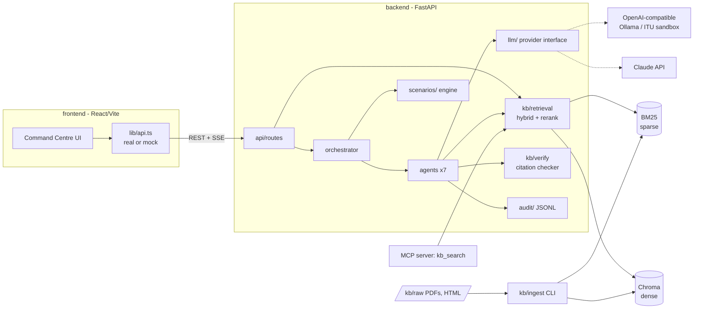

# Architecture

## 1. What we are building
A **governance layer** around a synthetic "smart pen" learning-difficulty screening service for middle-school students. It provides:
1. E-QANUN-style legal search over UAE legislation, with verified citations.
2. Specialist regulator agents and a Coordinator.
3. A progressive scenario engine.
4. A gap analyst that compares UAE sources with global examples.
5. A full audit trail.

Everything is mapped to ITU-T Y.3172 nodes and the ITU AI Readiness dimensions.

## 2. Key decisions

| # | Decision | Choice | Why / alternative |
|---|---|---|---|
| D1 | Repo | Monorepo, `frontend` ↔ `backend` only over documented HTTP | Brief requirement. Enables parallel work against `docs/api.md` |
| D2 | LLM access | `LLMProvider` protocol with 3 implementations: `anthropic` (default), `openai_compat`, `mock`. One env var `LLM_PROVIDER` | `openai_compat` covers Ollama (which the reference repo uses), vLLM, and most sandboxes |
| D3 | Grounding | **Retrieve-then-generate** run by our code, not by model tool calls | Grounding must not depend on the provider supporting tools. Agents also get `kb_search` as an optional tool when the provider supports it |
| D4 | Embeddings | **Proposed:** `BAAI/bge-m3` (multilingual incl. Arabic, 8k context) + `bge-reranker-v2-m3`. Runs locally or via Ollama (`bge-m3`) | The reference repo's `nomic-embed-text` is English-centric, so Arabic recall would suffer. Lighter fallback: `intfloat/multilingual-e5-base`. **Needs your confirmation (Phase 2)** |
| D5 | Vector store | Chroma (persistent, cosine), the same as the reference repo. BM25 via `rank-bm25` held in memory | KB is small (~thousands of chunks). FAISS is only worth it if Chroma gets in the way |
| D6 | Chunking | One chunk per Article. Split long articles into parts that keep the article number. Header-path prefix (`Law > Chapter > Article`) embedded with the text | Article-level citations are the product. The reference repo's fixed 256-word chunks would split articles |
| D7 | Refusal | Score threshold on the reranker output, calibrated on the eval set | Brief requirement. The threshold is a config value, not hard-coded |
| D8 | Verification | Deterministic checker after generation: each `[cN]` must map to a retrieved chunk, and each quote must be an exact (normalised) substring. Otherwise the claim is removed and reported | Provider-independent. Claude's Citations API can add a second layer when `LLM_PROVIDER=anthropic` |
| D9 | Orchestration | **Simple custom asyncio orchestrator**, not LangGraph | Scenario flow is deterministic (event → visible agents in parallel → coordinator), so a graph framework adds learning cost without much benefit. Easy to revisit |
| D10 | Audit | Append-only JSONL, one line per call, schema = `AuditEntry` | Greppable, exportable, crash-safe. Same object serves UI and export |
| D11 | Streaming | SSE. GET + `EventSource` for scenarios; POST + fetch-stream for `/ask` | Simpler than WebSockets. One-way is all we need |
| D12 | Frontend data | React Query for server state, Zustand for UI state (lang, theme) | — |
| D13 | Mock mode | `VITE_MOCK=true` swaps `lib/api.ts` to fixtures | Demo video can be recorded even with the backend down |

## 3. Request flow: `POST /api/ask`
1. **Detect language** (Arabic-script regex, fallback `langdetect`).
2. **Rewrite and expand** (router model, JSON output): legal search terms in EN and AR, plus domain tags. Example: "can the app show ads to kids" → "advertising to minors / الإعلان للأطفال / consent / children's data".
3. **Hybrid retrieve**: dense (bge-m3) + BM25 over both languages, filtered by `layer` and `status != repealed`. Merge with reciprocal-rank fusion. Exact article-number matches are boosted.
4. **Rerank** the top 30 down to the top 8. **If the best score is below the threshold, return `no_source`** (no LLM call) and log it.
5. **Generate** with the answer-format system prompt (cached). Chunks are passed as numbered sources. Rule: only state names, numbers, dates or penalties that appear in sources.
6. **Verify citations** (D8). Strip unverifiable claims and add warnings.
7. **Tag** pipeline nodes and readiness dimensions (from chunk domain tags plus a router-model classification). Set `requires_human_decision` when a child is affected.
8. **Audit-log** everything and return the response (or stream: `retrieval` → `token`… → `verification` → `final`).

## 4. Agents
All agents are the same `Agent` class configured with different values: a mandate prompt, `visible_kb_filter` (layers/domains), and `visible_event_fields`. Each agent:
`receive(event)` → retrieve (its filter) → assess (JSON: summary, recommendation, confidence, citations, nodes, dimensions) → verify → log.

| Agent | KB focus | Primary nodes |
|---|---|---|
| Legal & Policy Adviser | all UAE layers | any |
| Data Protection Authority | children's data, consent, purpose limitation, retention, cross-border | PP, M, D |
| Education Ministry | school rules, counsellor review, inclusion | C, P, SINK |
| Consumer Protection | in-app purchases, dark patterns, ads to minors | SINK, D |
| AI Ethics Oversight | AI ethics/strategy, inferred-disability signals, sanctions | M, P, D |
| Coordinator | sees assessments, not raw events | all |
| Gap Analyst | UAE layers + `global_example` | all |

The **Coordinator** collects the independent assessments for an event. It finds conflicts deterministically first (different recommended action on the same topic, or a confidence gap) and then explains them with the LLM. Output: a recommendation plus `requires_human_decision`, which opens a review.

**Information asymmetry:** `scenarios/*.yaml` sets `visible_to` per event. The engine shows each agent only its own feed. The Coordinator can forward items to other agents, and every forward is logged.

## 5. Scenario engine
State per run: released events, per-agent inbox, assessments, reviews. `POST /next` releases one event. The engine then runs the visible agents in parallel (`asyncio.gather`), then the Coordinator, and emits every step to the run's SSE queue. Runs are kept in memory and their audit lines go to the JSONL log. An `expected_handling` list in the YAML feeds the evaluation (did the agents reach the expected actions?).

## 6. Claude-specific features (used when `LLM_PROVIDER=anthropic`, with graceful degradation)
- **Prompt caching** on long, stable system prompts (agent mandates, answer format). Already wired: `cache_system=True`.
- **Haiku for routing** (query rewrite, node/dimension tagging); Sonnet for answers and assessments.
- **Structured JSON** for assessments, gaps and logs, validated with Pydantic and retried once on failure.
- **Citations API / search-result blocks** as an optional second verification layer.
- **Tool use** for `kb_search` follow-up queries inside agents (optional).

## 7. MCP server
`backend/app/kb/mcp_server.py` (Phase 3) exposes `kb_search(query, layers?, lang?, top_k?)` and `kb_get_article(doc_id, article)` over stdio, using the same retrieval service. Any MCP client (Claude Desktop, other teams) can query the KB.

## 8. Reuse from `CrashingGuru/ITUAIReadiness`
Reviewed: `simulation/server/knowledge/{ingest,kb}.py`, `agents/base.py`, `data/framework/dimensions.json`.
- **Reuse:** parse cascade (docling → PyMuPDF fallback; HTML strip), Chroma persistent client with cosine space, metadata-inference idea, the KB + agents + FastAPI layout, and the Ollama-style local model setup (our `openai_compat`).
- **Change:** structure-aware article chunking instead of fixed word windows; multilingual embeddings instead of `nomic-embed-text`; hybrid BM25; explicit metadata from `sources.csv` instead of filename regexes.
- **Note:** their `dimensions.json` uses the Readiness Framework v2.0 dimension names, which differ from the 8 dimensions in our brief. We use the brief's list and cross-reference in `y3172_mapping.md` (to confirm with the organisers).

## 9. Plan (today → 8 Dec 2026 ≈ 4 weeks, up to 4 people)

| Week | Dates | KB / retrieval (A) | Backend agents (B) | Frontend (C) | Docs / sources / report (D) |
|---|---|---|---|---|---|
| 1 | 7–13 Nov | Phase 2 ingest + eval harness | Phase 3 `/ask` + verifier | Shell, search, answer view (mock) | Verify and download 10–15 sources, write 50 eval Qs |
| 2 | 14–20 Nov | Tune threshold, add AR translations | Phase 4 agents + Coordinator | Agent council, audit terminal | Gap-analysis global sources |
| 3 | 21–27 Nov | Expand KB, MCP server | Phase 5 scenarios, Phase 6 gaps | Pipeline map, simulator, gaps board | Report draft |
| 4 | 28 Nov–7 Dec | Freeze KB, final eval numbers | Hardening, Docker | Polish, RTL, a11y, mock recordings | Demo video, report final |

**Cut list if behind** (in this order): 3D pipeline (use React Flow 2D), Azerbaijani labels, light theme, MCP server, LangGraph (never needed).

## 10. Risks
- **Source availability.** Official English translations may be missing for some laws. Mitigation: Arabic-first answers.
- **Arabic PDF extraction quality** (ligatures, RTL order). Mitigation: prefer official HTML pages, and spot-check 5 articles per document.
- **Threshold miscalibration** causing false refusals. Mitigation: eval set with explicit refusal questions.
- **Sandbox model quality** for Arabic JSON output. Mitigation: Pydantic validation + retry, keep prompts short.
